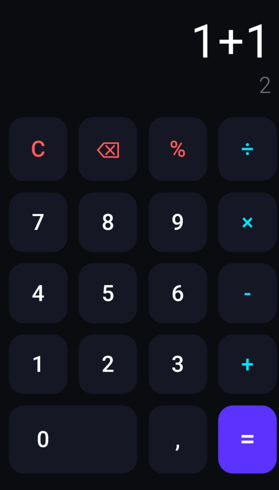

# Kalkulator 📱

Kalkulator simpel, modern, dan ringan dengan desain *dark mode*. Dibuat murni menggunakan HTML, CSS, dan JavaScript tanpa library tambahan. Cocok banget buat nemenin ngitung cepat di HP atau PC.

## ✨ Fitur Utama
- 🚀 **Live Preview**: Hasil perhitungan langsung muncul di bawah secara *real-time* sebelum lo pencet tombol `=`.
- 📏 **Anti-Overflow**: Angka yang panjang otomatis mengecil dan bergeser, jadi nggak bakal keluar dari layar.
- 🔢 **Format Ribuan**: Hasil otomatis pakai titik pemisah (contoh: `282.429.536.481`).
- 🌙 **Desain Modern**: Tampilan gelap dengan gaya *Neubrutalism* yang nyaman di mata.

## 🎮 Cara Pakai
Klik tombol **Live Demo** di atas, atau langsung buka link di bawah ini:

👉 **[mekinjir.github.io/kalkulator](https://mekinjir.github.io/kalkulator/)**

*(Nggak perlu install apa-apa, tinggal buka di browser HP atau PC).*

---
Dibuat dengan 💻 oleh [mekinjir](https://github.com/mekinjir).
